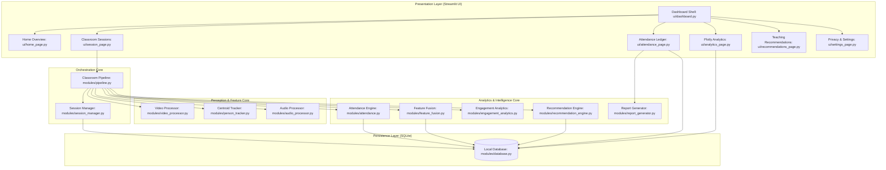
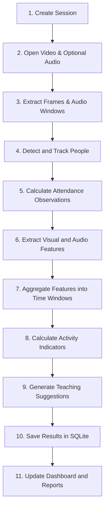

# Multimodal Attendance & Engagement Agent

[](https://www.python.org/)
[](https://streamlit.io/)
[](https://www.sqlite.org/)
[](tests/)
[](#-privacy-by-design--ethical-safeguards)
[](LICENSE)

An **offline-first classroom intelligence application** that records verified session attendance, analyzes observable classroom activity using video and optional audio streams, generates deterministic pedagogical teaching suggestions, and provides interactive analytics through an educator dashboard.

---

## 📑 Table of Contents

1. [Academic Abstract & Design Philosophy](#-academic-abstract--design-philosophy)
2. [System Architecture](#-system-architecture)
3. [Implemented Features vs. Planned Roadmap](#-implemented-features-vs-planned-roadmap)
4. [Algorithms & Scientific Methodology](#-algorithms--scientific-methodology)
5. [Attendance Verification Workflow](#-attendance-verification-workflow)
6. [Multimodal Feature Fusion & Missing Modalities](#-multimodal-feature-fusion--missing-modalities)
7. [Deterministic Recommendation Rules Engine](#-deterministic-recommendation-rules-engine)
8. [Installation & Execution Guide](#-installation--execution-guide)
9. [Demonstration Workflows](#-demonstration-workflows)
10. [Automated Testing & Verification](#-automated-testing--verification)
11. [Privacy by Design & Ethical Safeguards](#-privacy-by-design--ethical-safeguards)
12. [Known Limitations & Epistemic Modesty](#-known-limitations--epistemic-modesty)
13. [Clean Environment & Data Leakage Prevention](#-clean-environment--data-leakage-prevention)

---

## 🔬 Academic Abstract & Design Philosophy

Educational environments increasingly benefit from observational telemetry to help instructors gauge lesson pacing, student sustained presence, and dynamic instructional balance (e.g., lecture monologue vs. collaborative discussion). However, conventional computer vision solutions often deploy intrusive biometric facial recognition or black-box neural networks that predict unobservable emotional or cognitive states.

The **Multimodal Attendance & Engagement Agent** is built around three core principles:
1. **Epistemic Modesty:** The system measures physical observables only—spatial bounding geometries, centroid displacements, and acoustic speech energy ratios. It explicitly **rejects** inferring internal student emotions, intelligence, attentiveness, or comprehension.
2. **Privacy by Design:** Raw video frames and audio waveforms are processed ephemerally in volatile RAM (`np.ndarray`) and discarded immediately after feature extraction. No raw recordings are written to disk. Student identities are never inferred biometrically; they are bound to anonymous spatial tokens (`Track-01`, `Track-02`) strictly via teacher confirmation.
3. **100% Offline Autonomy:** The entire pipeline executes locally on standard CPU hardware without external API egress, cloud dependencies, or remote telemetry.

---

## 🏛️ System Architecture

The application adopts a modular, unidirectional architecture where sensory ingestion, tracking, analytics, rule evaluation, persistence, and presentation are completely decoupled.

### Layered Architecture



### The 11-Stage Pipeline Processing Flow

Each session executes through an immutable 11-stage pipeline lifecycle:



---

## 📁 Repository Directory Structure

```
multimodal-attendance-agent/
│
├── 🚀 Application Entry & Governance
│   ├── app.py                      # Main Streamlit application entrypoint & routing
│   ├── DEMO_GUIDE.md               # Complete evaluator demonstration guide & test workflows
│   ├── requirements.txt            # Production Python dependencies
│   ├── README.md                   # System documentation & architectural reference
│   ├── requirements.md             # Formal SRS functional specification & blueprint
│   ├── pytest.ini                  # Pytest configuration, coverage & testpaths
│   └── .gitignore                  # Git ignore rules (DBs, media, exports, caches)
│
├── ⚙️ config/
│   └── settings.py                 # Centralized typed configuration dataclasses & defaults
│
├── 🧠 modules/                     # Decoupled Core Perception & Business Logic
│   ├── __init__.py                 # Public package interface exports
│   ├── pipeline.py                 # 11-stage multimodal orchestrator
│   ├── session_manager.py          # Session state machine (READY/ACTIVE/PAUSED/CONCLUDED)
│   ├── video_processor.py          # Video ingestion, OpenCV detection, motion delta & overlays
│   ├── person_tracker.py           # Anonymous CentroidTracker and Track trajectory state
│   ├── attendance.py               # Sustained-presence thresholding & roster claims
│   ├── audio_processor.py          # Acoustic feature extraction (RMS, ZCR, Centroid, VAD)
│   ├── feature_fusion.py           # Temporal alignment into standardized 30s windows
│   ├── engagement_analytics.py     # Observable activity dynamics & transition trends
│   ├── recommendation_engine.py    # Deterministic rule-based pedagogical suggestion engine
│   ├── database.py             # SQLite persistence layer with WAL mode and cascades
│   └── report_generator.py     # RFC 4180 CSV export builders for attendance ledgers
│
├── 🖥️ ui/                          # Streamlit Presentation Layer
│   ├── __init__.py                 # UI package exports
│   ├── dashboard.py                # Main layout shell, CSS styling & persistent sidebar
│   ├── home_page.py                # System status, KPI metrics & privacy principles
│   ├── session_page.py             # Live session controls, stream player & batch processing
│   ├── attendance_page.py          # Tabbed attendance ledgers, events log & CSV exports
│   ├── analytics_page.py           # Interactive Plotly dynamics & observation limitations
│   ├── recommendations_page.py     # Pedagogical cues, acknowledgment controls & rule catalog
│   ├── settings_page.py            # Privacy controls, retention schedules & DB purge tools
│   └── demo_data.py                # Isolated synthetic demonstration session generator
│
├── 🧪 tests/                       # Automated Test Suites (138 Passing Tests)
│   ├── test_end_to_end_integration.py # Full lifecycle end-to-end integration tests
│   ├── test_privacy_security.py       # Air-gap, zero-media storage, and path sanitization tests
│   ├── test_qa_edge_cases.py          # Corrupt frames, empty audio, SQL injection & leak tests
│   ├── test_pipeline.py               # Pipeline orchestrator & batch loop tests
│   ├── test_video_processor.py        # OpenCV frame decoding & detector fallback tests
│   ├── test_audio_processor.py        # Librosa audio features, VAD & chunk processing tests
│   ├── test_person_tracker.py         # Centroid & IoU bounding box tracking tests
│   ├── test_attendance.py             # Sustained presence, transient filtering & threshold tests
│   ├── test_feature_fusion.py         # Temporal window alignment & quality score tests
│   ├── test_analytics.py              # Normalized composite activity indicator tests
│   ├── test_recommendations.py        # Deterministic pedagogical rule trigger tests
│   ├── test_database.py               # SQLite schema, cascades, and transaction tests
│   └── test_ui.py                     # Streamlit component export & demo tour tests
│
├── 📦 data/                        # Local Storage (Excluded from Git)
│   ├── .gitkeep                    # Retains folder in Git
│   ├── attendance_agent.db         # Local SQLite database (WAL mode, parameterized queries)
│   ├── exports/                    # Auto-generated CSV exports
│   └── sample/                     # Bundled evaluation assets (tracked in Git)
│       ├── classroom_demo.mp4      # Pre-recorded 10s offline video (3 tracked students, 10 FPS)
│       └── sample_roster.csv       # Non-sensitive sample student roster
│
└── 📚 docs/
    └── architecture.md             # Comprehensive architectural blueprint and design notes
```

---

## 📊 Implemented Features vs. Planned Roadmap

To maintain strict academic integrity, the following matrix distinguishes fully implemented and verified functionality from planned future enhancements:

| Feature / Capability | Implementation Status | Verification Reference |
|:---|:---:|:---|
| **Multi-Source Video Ingestion** (Webcams & Files) | ✅ Completed | [video_processor.py](file:///Users/divyaverma/multimodal-attendance-agent/modules/video_processor.py), `test_video_processor.py` |
| **Bundled Offline Demo Video** (`classroom_demo.mp4`) | ✅ Completed | `data/sample/classroom_demo.mp4`, `test_ui.py` |
| **Anonymous Spatial Person Tracking** | ✅ Completed | [person_tracker.py](file:///Users/divyaverma/multimodal-attendance-agent/modules/person_tracker.py), `test_person_tracker.py` |
| **Non-Maximum Suppression (NMS) & IoU Filtering** | ✅ Completed | [person_tracker.py](file:///Users/divyaverma/multimodal-attendance-agent/modules/person_tracker.py), `test_person_tracker.py` |
| **Sustained-Presence Attendance Engine** | ✅ Completed | [attendance.py](file:///Users/divyaverma/multimodal-attendance-agent/modules/attendance.py), `test_attendance.py` |
| **Separation of Verified vs. Provisional Attendance** | ✅ Completed | [attendance_page.py](file:///Users/divyaverma/multimodal-attendance-agent/ui/attendance_page.py), `test_ui.py` |
| **Chronological Attendance Events Audit Log** | ✅ Completed | [attendance_page.py](file:///Users/divyaverma/multimodal-attendance-agent/ui/attendance_page.py), `test_database.py` |
| **Teacher Manual Overrides & Roster Binding** | ✅ Completed | [attendance_page.py](file:///Users/divyaverma/multimodal-attendance-agent/ui/attendance_page.py), `test_attendance.py` |
| **RFC 4180 CSV Export** (Ledgers & Event Logs) | ✅ Completed | [report_generator.py](file:///Users/divyaverma/multimodal-attendance-agent/modules/report_generator.py), `test_ui.py` |
| **Acoustic Feature Extraction & Energy VAD** | ✅ Completed | [audio_processor.py](file:///Users/divyaverma/multimodal-attendance-agent/modules/audio_processor.py), `test_audio_processor.py` |
| **Multimodal Synchronized Feature Fusion (30s)** | ✅ Completed | [feature_fusion.py](file:///Users/divyaverma/multimodal-attendance-agent/modules/feature_fusion.py), `test_feature_fusion.py` |
| **Interactive Plotly Time-Series Visualizations** | ✅ Completed | [analytics_page.py](file:///Users/divyaverma/multimodal-attendance-agent/ui/analytics_page.py), `test_ui.py` |
| **Sensor Disconnection & Gap Preservation (No $0.0$)** | ✅ Completed | [analytics_page.py](file:///Users/divyaverma/multimodal-attendance-agent/ui/analytics_page.py), `test_analytics.py` |
| **Deterministic Recommendation Engine (8 Rules)** | ✅ Completed | [recommendation_engine.py](file:///Users/divyaverma/multimodal-attendance-agent/modules/recommendation_engine.py), `test_recommendations.py` |
| **Teacher Suggestion Acknowledgment Workflow** | ✅ Completed | [recommendations_page.py](file:///Users/divyaverma/multimodal-attendance-agent/ui/recommendations_page.py), `test_database.py` |
| **Fast Batch Video Runner** (`⚡ Fast-Process`) | ✅ Completed | [session_page.py](file:///Users/divyaverma/multimodal-attendance-agent/ui/session_page.py), `test_pipeline.py` |
| **One-Click Synthetic Demo Tour Mode** (`[DEMO]`) | ✅ Completed | [demo_data.py](file:///Users/divyaverma/multimodal-attendance-agent/ui/demo_data.py), `test_ui.py` |
| **Configurable Data Retention & Auto-Purge** | ✅ Completed | [database.py](file:///Users/divyaverma/multimodal-attendance-agent/modules/database.py), `test_database.py` |
| **Permanent Session Deletion (Cascade Cleanup)** | ✅ Completed | [database.py](file:///Users/divyaverma/multimodal-attendance-agent/modules/database.py), `test_privacy_security.py` |
| **Ephemeral RAM Media Streams (Zero Raw Disk Storage)** | ✅ Completed | [video_processor.py](file:///Users/divyaverma/multimodal-attendance-agent/modules/video_processor.py), `test_privacy_security.py` |
| **Multi-Camera Re-Identification (Across Rooms)** | 🔮 *Planned Future Work* | *Not implemented in current single-room architecture* |
| **Hardware GPU Acceleration (CUDA / Apple Metal)** | 🔮 *Planned Future Work* | *Currently optimized for standard CPU execution* |
| **BLE Beacon / RFID Token Integration** | 🔮 *Planned Future Work* | *Currently relies on visual centroid dwell-time* |
| **Cross-Institutional Federated Analytics** | 🔮 *Planned Future Work* | *Currently operates strictly within local SQLite* |

---

## 🧮 Algorithms & Scientific Methodology

### 1. Person Detection & Multi-Tier Cascade
Person detection operates via an offline multi-tier cascade without cloud model downloads:
1. **Haar Cascade Classifiers:** Uses OpenCV's frontal face and upper body cascade filters.
2. **HOG + Linear SVM Detector:** Built-in OpenCV Histogram of Oriented Gradients (`cv2.HOGDescriptor.getDefaultPeopleDetector()`) trained on pedestrian profiles.
3. **High-Contrast Silhouette / Contour Analysis:** Thresholding fallback for synthetic and contrast-isolated video streams that segments active bounding boxes using aspect ratio bounds ($0.6 \le \frac{h}{w} \le 4.5$) and area bounds ($0.8\% \le \text{Area} \le 40\%$).

### 2. Multi-Object Spatial Tracking (CentroidTracker)
Anonymous multi-object tracking uses centroid distance minimization:
1. For each incoming detection bounding box $B_j = (x, y, w, h)$, the centroid is calculated as:
   $$c_j = \left(x + \frac{w}{2}, \; y + \frac{h}{2}\right)$$
2. A Euclidean distance cost matrix $D_{i,j} = \|c_i - c_j\|_2$ is computed between existing active tracks $i$ and candidate detections $j$.
3. Hungarian/greedy association pairs centroids satisfying $D_{i,j} \le \text{max\_distance\_px}$ ($50\text{ px}$).
4. Unmatched tracks enter a deregistration grace period of $\text{max\_lost\_frames} = 10$ frames ($1.0\text{s}$ at $10\text{ FPS}$) to maintain trajectory continuity during brief occlusions.
5. Overlapping detections are merged using **Non-Maximum Suppression (NMS)** with an Intersection-over-Union (IoU) threshold of $0.40$.

### 3. Visual Movement Index
Motion dynamics represent relative pixel displacement between consecutive video frames:
1. Current frame $I(t)$ and previous frame $I(t-1)$ are converted to greyscale and smoothed with a Gaussian kernel ($21 \times 21$).
2. Absolute difference frame:
   $$\Delta(t) = |I(t) - I(t-1)|$$
3. Thresholding at intensity $25$ produces a binary motion mask $M(t)$. The raw motion ratio is computed as:
   $$r_{\text{motion}} = \frac{\sum M(t)}{\text{Total Pixels}}$$
4. Normalized to a $0–100\%$ scale:
   $$\text{Movement Index} = \min\left(100.0, \; \frac{r_{\text{motion}}}{0.15} \times 100\right)$$

### 4. Acoustic Features & Voice Activity Detection (VAD)
Audio waveforms are sampled locally at $16\text{ kHz}$ in 1-second chunks:
- **Root-Mean-Square (RMS) Energy:**
  $$\text{RMS} = \sqrt{\frac{1}{N}\sum_{n=1}^N x[n]^2}$$
- **Zero-Crossing Rate (ZCR):**
  $$\text{ZCR} = \frac{1}{2N}\sum_{n=1}^{N-1} |\text{sgn}(x[n]) - \text{sgn}(x[n-1])|$$
- **Spectral Centroid:** Represents acoustic brightness/frequency center of mass.
- **Energy-Adaptive VAD:** Frames with $\text{RMS} > \theta_{\text{silence}}$ ($0.015$) and $\text{ZCR} \in [0.02, 0.40]$ are classified as active vocal speech. The **Speech Activity Ratio (%)** is the percentage of frames classified as speech over the time window.

---

## ⏱️ Attendance Verification Workflow

The attendance lifecycle ensures transparent, verifiable records with a strict separation between provisional observations and verified roll sheets:

```
[Subject Enters FOV]
       │
       ▼
[Track Registered: Track-01]  ──►  Log Event: FIRST_SEEN
       │
       ▼
[Active Session Dwell Time Accumulation]
       │
       ├── Dwell Time < 30s                  ──►  Status: TRANSIENT (Filtered passer-by)
       ├── Dwell Time >= 30s & < Threshold   ──►  Status: PROVISIONAL (In-progress)
       └── Dwell Time >= Threshold (e.g. 60%)──►  Status: SUSTAINED_PRESENT (Verified)
                                                         │
                                                         ▼
                                            Log Event: SUSTAINED_PRESENCE_MET
                                                         │
       ┌─────────────────────────────────────────────────┴─────────────────────────────┐
       ▼                                                                               ▼
[Automatic Roster Auto-Claim]                                             [Teacher Manual Claim & Override]
If voluntary token/seat match exists.                                      Teacher binds Track-01 to Enrolled Student.
                                                                           Log Event: MANUAL_CORRECTION
```

### Attendance Status Classifications

| Status | Threshold Criteria | Included in Official Roll? | Rationale |
|:---|:---|:---:|:---|
| `SUSTAINED_PRESENT` | Observed active duration $\ge$ threshold (e.g., 60% of session) | **Yes** | Demonstrates sustained physical participation in the classroom. |
| `PROVISIONAL` | Observed active duration $\ge 30\text{s}$ but $<$ threshold | **No** | Participant arrived late, departed early, or session is still in progress. |
| `PARTIAL` | Observed for a substantial segment but below full qualification | **No** | Provides an audit trail for excused departures or temporary visits. |
| `TRANSIENT` | Observed active duration $< 30\text{s}$ | **No** | Automatically filters out hallway passers-by or message deliverers. |
| `ABSENT` | Enrolled student with zero matching tracking observations | **No** | Student did not appear in verified records. |

---

## 🔀 Multimodal Feature Fusion & Missing Modalities

The `FeatureFusionEngine` synchronizes visual tracking samples ($10\text{ FPS}$) and acoustic feature chunks ($16\text{ kHz}$) into fixed **30-second time windows**:

```
Visual Timeline:  [frame1] [frame2] ... [frameN]  ──► Mean Headcount, Mean Movement Index
Acoustic Timeline:[chunk1] [chunk2] ... [chunkM]  ──► Mean Speech %, Mean RMS Loudness
                               │
                               ▼
            Synchronized 30-Second Multimodal Window
            - window_start_sec / window_end_sec
            - active_person_count (int or None)
            - visual_movement_index (float or None)
            - speech_activity_pct (float or None)
            - data_quality_score (0.0 to 1.0)
            - data_quality_label ("HIGH", "PARTIAL_VISUAL_ONLY", etc.)
```

### Handling Missing Modalities (Anti-Fabrication Guarantee)
If a microphone is disconnected or camera stream is occluded:
- The system **never** replaces missing data with fabricated or interpolated values.
- Missing values are explicitly stored as `NULL` / `None` in SQLite.
- Time-series charts display **discontinuities (clean gaps)** rather than false drops to $0.0$, preventing educators from misinterpreting a muted microphone as a silent classroom.

---

## 💡 Deterministic Recommendation Rules Engine

The teaching suggestion engine uses deterministic, transparent heuristic rules that evaluate consecutive time windows. All suggestions are optional, non-evaluative decision support cues:

| Rule Code | Trigger Condition | Multi-Window Horizon | Pedagogical Recommendation |
|:---|:---|:---:|:---|
| `RULE_PROLONGED_MONOLOGUE` | Speech ratio $> 80\%$ continuously | $\ge 20$ windows ($10\text{ min}$) | Introduce a quick Q&A activity, short poll, or peer discussion. |
| `RULE_EXTENDED_SILENCE` | Speech ratio $< 5\%$ and RMS $< 0.01$ | $\ge 6$ windows ($3\text{ min}$) | Invite voluntary participant reflections or provide a structured prompt. |
| `RULE_CONDUCT_RECAP` | Speech $> 65\%$ block followed by lull ($< 20\%$) | $13\text{ min}$ transition | Conduct a short 2-minute synthesis recap of core concepts. |
| `RULE_RESTLESSNESS_SPIKE` | Movement $> 70\%$ and speech $< 15\%$ | $\ge 6$ windows ($3\text{ min}$) | Offer a 60-second stretch, topic transition, or active breakout. |
| `RULE_CHECK_AUDIO_QUALITY` | Missing audio windows or buffer drops | $\ge 3$ consecutive windows | Check microphone placement, input level, or hardware connection. |
| `RULE_CHECK_CAMERA_ANGLE` | Zero headcount detected during active session | $\ge 3$ consecutive windows | Review camera tilt, field-of-view coverage, or room lighting glare. |
| `RULE_PRESENCE_DROP` | Headcount drops $> 30\%$ vs. baseline | $5$-window horizon | Check if camera was bumped or students stepped out for a break. |
| `RULE_MAINTAIN_ACTIVITY` | Balanced speech ($20–70\%$) & motion ($10–60\%$) | $\ge 10$ windows ($5\text{ min}$) | Pacing is balanced; continue current instructional activity. |

---

## 💻 Installation & Execution Guide

### Prerequisites
- **Operating System:** macOS (Apple Silicon or Intel), Linux (Ubuntu/Debian), or Windows 10/11
- **Python Version:** Python 3.10, 3.11, 3.12, or 3.13
- **Hardware:** Standard CPU (no GPU required); Webcam and Microphone optional

### Clean Installation from Source
```bash
# 1. Clone the repository
git clone https://github.com/your-username/multimodal-attendance-agent.git
cd multimodal-attendance-agent

# 2. Create a clean virtual environment
python3 -m venv .venv

# 3. Activate the virtual environment
source .venv/bin/activate       # On Windows: .venv\Scripts\activate

# 4. Install production dependencies
pip install --upgrade pip
pip install -r requirements.txt

# 5. Verify installation by running unit tests
pytest -q
```
*Expected Test Output:* `138 passed in ~5s`.

### Launching the Dashboard
```bash
streamlit run app.py
```
Open **`http://localhost:8501`** in any web browser.

---

## 🎬 Demonstration Workflows

For step-by-step evaluator instructions, see [DEMO_GUIDE.md](file:///Users/divyaverma/multimodal-attendance-agent/DEMO_GUIDE.md). The application provides three air-gapped demonstration routes:

### Route 1: Instant Synthetic Demo Tour (Zero Hardware Required)
1. On the **Home** or **Classroom Sessions** page, click:
   $$\boxed{\text{📥 Load Synthetic Sample Session [DEMO]}}$$
2. Inspect the **Attendance Ledger**:
   - Tab 1: `✅ Verified Attendance (3)` (met 60% sustained threshold).
   - Tab 2: `⏳ Provisional & In-Progress (3)` (partial attendees and transient passer-by).
   - Tab 3: `📜 Attendance Events Log (3)` (timestamped entries, threshold qualifications).
3. Test **Teacher Manual Override**: Assign Track-3 to an enrolled student (`Diana Prince`) or override status.
4. Download CSVs: Click `Download Verified Attendance CSV` and `Download Attendance Events Log CSV`.
5. Inspect **Analytics**: View Plotly speech ratio %, movement %, headcount, and missing sensor gaps.
6. Inspect **Recommendations**: Acknowledge pending suggestions (`RULE_PROLONGED_MONOLOGUE`).

### Route 2: Pre-Recorded Video Pipeline (`classroom_demo.mp4`)
1. On **Classroom Sessions**, enter Course Code `DEMO101` and Title `Offline Video Demonstration`.
2. Select **Recorded Video File** $\to$ **Sample Demo Video** (`data/sample/classroom_demo.mp4`).
3. Check the institutional privacy consent box and click **Create Session** $\to$ **▶️ Start Session**.
4. Observe real-time anonymous perception overlays (`Person 1`, `Person 2`, `Person 3`).
5. Click **`⚡ Fast-Process Entire Video`** to process all 100 frames through tracking, fusion, and SQLite in ~2 seconds.
6. Verify attendance records and timestamped events automatically sync to SQLite.

### Route 3: Live Hardware Webcam & Microphone Demonstration
1. On **Classroom Sessions**, select **Live Webcam** (Device Index `0`).
2. Click **🔍 Test Camera** to confirm device accessibility and native resolution.
3. Check consent box and click **Create Session** $\to$ **▶️ Start Session**.
4. Test real-time anonymous person tracking and microphone speech detection.
5. Click **⏹️ Conclude** to safely release hardware handles and commit attendance.

---

## 🧪 Automated Testing & Verification

The test suite contains **138 automated unit, integration, and security tests** across 13 test suites:

```bash
# Run all tests with concise output
pytest -q

# Run all tests with verbose output
pytest -v

# Run specific subsystem test suites
pytest tests/test_pipeline.py              # 11-stage pipeline orchestrator tests
pytest tests/test_video_processor.py       # OpenCV ingestion and fallback detector tests
pytest tests/test_audio_processor.py       # VAD, RMS, and audio feature tests
pytest tests/test_person_tracker.py        # Centroid tracker, IoU, and NMS tests
pytest tests/test_attendance.py            # Sustained presence and roster claim tests
pytest tests/test_feature_fusion.py        # Temporal window aggregation tests
pytest tests/test_analytics.py             # Plotly analytics and dynamic shift tests
pytest tests/test_recommendations.py       # Deterministic rule trigger tests
pytest tests/test_database.py              # SQLite WAL mode, schema, and cascade tests
pytest tests/test_privacy_security.py      # Air-gap, zero-media, and path traversal tests
pytest tests/test_qa_edge_cases.py         # Corrupt inputs, empty audio, leak tests
pytest tests/test_ui.py                    # Streamlit AppTest headless navigation tests
pytest tests/test_end_to_end_integration.py# Full lifecycle integration tests
```

---

## 🛡️ Privacy by Design & Ethical Safeguards

1. **No Facial Recognition or Biometrics:** Human subjects are perceived strictly as 2D spatial bounding boxes and integer track IDs. The system contains zero facial recognition models, landmark embeddings, or biometric databases.
2. **Ephemeral In-RAM Media Streams:** All video frames (`cv2.Mat`) and audio waveforms (`np.ndarray`) exist transiently in RAM. `allow_save_frames` is locked to `False` by default; attempting to save frames raises a `PermissionError` security violation.
3. **Decoupled Identity Attributions:** Student roster names cannot be assigned automatically by an algorithm. Only an authorized educator can manually bind a track to a student ID in the attendance verification view.
4. **100% Air-Gapped Operation:** The core application contains zero network socket calls, cloud API requests, or remote telemetry.
5. **Configurable Data Retention & Right to Erasure:** Administrators can configure automatic retention purge windows (30, 60, 90 days) and permanently delete sessions with full relational cascade purging.

---

## ⚠️ Known Limitations & Epistemic Modesty

While designed with strict privacy-by-design patterns, institutional evaluators should recognize inherent real-world limitations:

1. **Host-Level Physical and Disk Security:**
   - The application relies on the security of the host workstation. Full-disk encryption (Apple FileVault, Windows BitLocker, Linux LUKS) must be enabled to protect local SQLite databases and CSV exports at rest.
2. **Field-of-View & Acoustic Bleed:**
   - Standard optical cameras and microphones cannot distinguish registered students from casual passers-by or hallway conversations. Educators should position sensors thoughtfully.
3. **Epistemic Modesty & Zero Psychological Claims:**
   - Visual movement reflects gross physical displacement (gesturing, shifting, board work). Acoustic ratios reflect vocal room energy.
   - The system **never** purports to measure internal emotional states, attentiveness, cognitive comprehension, or intelligence.
4. **Strict Non-Punitive Standard:**
   - Automated observation metrics must **never** be used for disciplinary actions, punitive grading penalties, or educator employment evaluations. All metrics are voluntary decision-support aids.

---

## 🔒 Clean Environment & Data Leakage Prevention

The repository is configured to prevent accidental leakage of student records or runtime databases:

- **`.gitignore` Rules:** Strictly exclude `data/attendance_agent.db*`, `data/exports/*.csv`, `data/temp/`, `data/recordings/`, `.env`, and Python virtual environments.
- **Allowed Sample Assets:** Only non-sensitive demonstration assets (`data/sample/classroom_demo.mp4`, `data/sample/sample_roster.csv`) are tracked.
- **Clean DB Initialization:** When cloned on a clean machine without an existing database, `DatabaseManager` automatically creates all required tables and schemas in SQLite with WAL mode on first launch.

---

## 📜 License & Institutional Notice

Distributed under the **Apache 2.0 License**. Intended for educational, academic, and research decision-support applications in compliance with institutional student data privacy policies (FERPA, GDPR, and institutional IRB standards).
