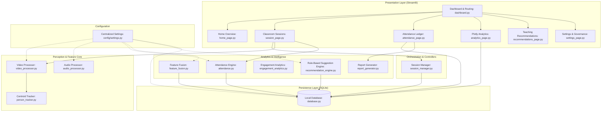
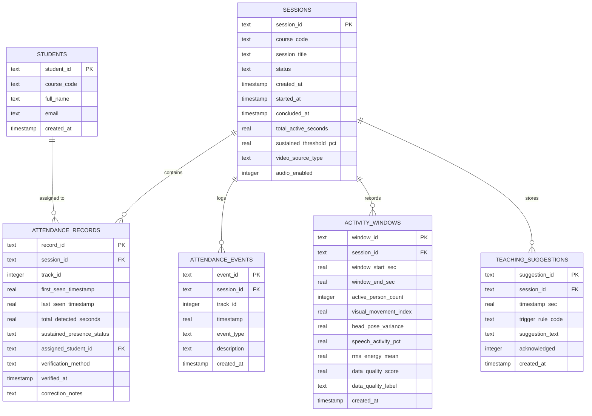

# Multimodal Attendance & Engagement Agent - Software Architecture

## 1. Architectural Philosophy

The **Multimodal Attendance & Engagement Agent** is architected around three foundational pillars:
1. **Decoupled Modularity:** Every concern—video ingestion, tracking, acoustic analysis, presence accumulation, pedagogical rules, presentation, and persistence—resides in isolated modules with unidirectional dependencies, eliminating circular references.
2. **Privacy by Design & Epistemic Modesty:** Raw audio and video frames exist ephemerally in RAM (`np.ndarray`) and are immediately discarded. Student names are never inferred via biometric facial recognition; instead, they are bound to anonymous spatial tracks strictly through teacher confirmation or student opt-in tokens.
3. **Offline Reliability:** All perception models and rule engines execute locally on standard CPU hardware without external API egress.

---

## 2. Layered Architecture Diagram



---

## 3. Module Responsibilities & Boundary Matrix

| Module | Source File | Responsibilities | Key Input / Output |
| :--- | :--- | :--- | :--- |
| **Settings** | `config/settings.py` | Centralized typed dataclasses for perception parameters, thresholds, and paths. | Env variables $\to$ `AppConfig` singleton. |
| **Database** | `modules/database.py` | Local SQLite management, WAL mode, tables, transactional queries, auto-purge. | SQL statements $\to$ typed row dictionaries. |
| **Session Manager** | `modules/session_manager.py` | State machine (`READY` $\leftrightarrow$ `ACTIVE` $\leftrightarrow$ `PAUSED` $\to$ `CONCLUDED`), elapsed active timers. | User actions $\to$ `SessionMetadata`. |
| **Person Tracker** | `modules/person_tracker.py` | Multi-object tracking (MOT) using Euclidean distance minimization; assigns anonymous IDs (`Track-01`). | Bounding boxes $\to$ `Dict[int, Track]`. |
| **Video Processor** | `modules/video_processor.py` | Ingestion from webcam/file, OpenCV Haar/YuNet detection, frame differencing motion score. | Raw frames $\to$ Annotated preview + active tracks + motion index. |
| **Audio Processor** | `modules/audio_processor.py` | Acoustic feature extraction: RMS loudness, Zero-Crossing Rate (ZCR), Spectral Centroid, and VAD speech ratio. | Audio waveform array $\to$ `AudioFeatures`. |
| **Attendance Engine** | `modules/attendance.py` | Sustained presence calculation, transient passer-by filtering, and teacher-confirmed roster claims. | `Track` list + active time $\to$ `AttendanceEvaluation`. |
| **Feature Fusion** | `modules/feature_fusion.py` | Aligns sub-second visual metrics and acoustic features into standardized time-window intervals (e.g., 30s). | Momentary samples $\to$ `MultimodalWindow`. |
| **Engagement Analytics** | `modules/engagement_analytics.py` | Non-judgmental timeline trend calculation, lecture/monologue vs discussion ratios. | `MultimodalWindow`s $\to$ Summary KPIs & DataFrames. |
| **Recommendation Engine** | `modules/recommendation_engine.py` | Evaluates deterministic pedagogical rules (prolonged monologue, extended silence, restlessness) with cooldowns. | Sliding windows $\to$ `Suggestion` cues. |
| **Report Generator** | `modules/report_generator.py` | Compiles attendance records into Pandas DataFrames, CSV exports, and downloadable binary streams. | SQLite records $\to$ CSV file & UTF-8 bytes. |

---

## 4. Concurrency & Ephemeral Pipeline

```
[Camera / Video File]
        │
        ▼ (Raw Frame np.ndarray in RAM)
[VideoProcessor: Haar/YuNet Detection]
        │
        ▼ (Bounding Boxes)
[CentroidTracker: Update Track Positions & Deltas]
        │
        ▼ (Anonymized Visual Overlays)
[Streamlit UI Display] ──► Frame dropped from RAM immediately (Zero persistence)
```

1. **Ephemeral Memory Guarantee:** Raw pixel arrays and raw audio buffers are stored solely as local NumPy arrays in memory. They are processed and discarded immediately upon computing bounding boxes and acoustic scalars.
2. **Subsampling Strategy:** Video decoding sub-samples incoming frames to 5–10 FPS, preventing CPU exhaustion on standard laptops.
3. **Decoupled Streamlit Rendering:** Streamlit views query structured state from `st.session_state` and local SQLite rather than coupling directly to lower-level OpenCV hardware loops.

---

## 5. Unidirectional Dependencies & Circular Import Prevention

To guarantee zero circular dependencies:
- `config/settings.py` depends on nothing inside `modules/` or `ui/`.
- `modules/database.py` depends only on standard libraries and `config/settings.py`.
- Perception and intelligence engines (`person_tracker`, `audio_processor`, `engagement_analytics`, `report_generator`) are purely computational and depend only on domain dataclasses.
- `ui/` consumes `modules/` and `config/`; `modules/` never imports anything from `ui/`.

---

## 6. Computer Vision Tracking Limitations & Mitigation Strategies

While the person tracking and sustained-presence algorithms operate robustly under standard classroom configurations, real-world deployments must account for physical and optical constraints:

### 6.1 Camera Placement & Field of View (FOV)
- **Constraint:** Standard laptop webcams have a restricted field of view ($\approx 60^\circ$–$78^\circ$). Students seated at extreme peripheral angles or in lecture hall tiers may fall outside the active frame.
- **Mitigation:** Position the camera elevated at the front of the classroom or use a wide-angle external USB camera ($\ge 90^\circ$ FOV).

### 6.2 Lighting Variations & Dynamic Backlighting
- **Constraint:** Classrooms with large exterior windows frequently introduce severe backlighting or lens glare, causing human silhouettes with low contrast that can evade edge and Haar detectors. Harsh fluorescent flicker can also degrade frame differencing.
- **Mitigation:** The pipeline applies histogram equalization (`cv2.equalizeHist`) and Gaussian smoothing (`cv2.GaussianBlur`) to grayscale representations, mitigating illumination variance.

### 6.3 Transient & Partial Occlusion
- **Constraint:** Students standing up, walking to whiteboards, or raising laptops can temporarily occlude individuals seated behind them. In naive trackers, occlusions cause immediate track termination.
- **Mitigation:** `CentroidTracker` implements a configurable `max_lost_frames` buffer (default: 30 frames). When a track is occluded, it transitions to `is_visible=False` while retaining its historical trajectory and ID, seamlessly re-associating when the subject emerges.

### 6.4 Close Proximity & ID Switching
- **Constraint:** In dense lecture halls where students sit side-by-side, centroids may fall within mutual distance thresholds ($D_{ij} < \text{max\_distance\_px}$), occasionally causing ID swaps or track merging.
- **Mitigation:** `apply_non_maximum_suppression()` eliminates duplicate overlapping bounding boxes on raw detections, and `AttendanceEngine` aggregates cumulative temporal presence rather than relying on unbroken single-track chains. Furthermore, teachers can easily merge or adjust unassigned slots in the attendance ledger.

---

## 7. Acoustic Analysis & Voice Activity Detection (VAD) Limitations

The acoustic analysis subsystem (`modules/audio_processor.py`) utilizes an offline, privacy-first multi-feature baseline Voice Activity Detector (VAD) evaluating short-time RMS energy, Zero-Crossing Rate (ZCR), and spectral centroid across 30ms subframes. While computationally lightweight and zero-dependency, real-world educational acoustic environments exhibit the following inherent physical and algorithmic limitations:

### 7.1 Room Reverberation & Multipath Reflections
- **Limitation:** Classrooms and lecture halls typically contain acoustic boundaries (plaster walls, glass windows, polished floors, whiteboards) that generate acoustic reflections. Reverberant decay trails can maintain signal energy above the VAD threshold for 200–500ms after vocalization ends.
- **Consequence:** Raw speech duration calculations may moderately overestimate vocalization lengths in untreated, high-reverberation rooms.
- **Mitigation:** Subframe evaluation (30ms) paired with multi-parameter spectral criteria (ZCR and Spectral Centroid) suppresses low-frequency reverberant rumblings compared to naive energy-only gating.

### 7.2 Non-Speech Transients & Classroom Noise Artifacts
- **Limitation:** Everyday classroom mechanical and impulsive noises—such as chair scraping, door slams, keyboard typing, paper shuffling, coughing, or dropped pens—can produce brief high-amplitude spikes.
- **Consequence:** Impulsive clicks can occasionally trip short-time energy gates.
- **Mitigation:** Broadband impulsive spikes typically display either excessively high Zero-Crossing Rates (fricative/white noise profile $> 0.40$) or spectral centroids outside human vocal resonance ($> 4800\text{ Hz}$), causing the multi-feature validator to reject them. Furthermore, the 15% subframe density threshold prevents isolated single-pulse transients from classifying an entire chunk as speech.

### 7.3 Distance Attenuation & Lack of Spatial Beamforming
- **Limitation:** A standard monaural or stereo laptop microphone exhibits omnidirectional pickup without directional beamforming. Acoustic energy decays according to the inverse-square law ($I \propto 1/r^2$).
- **Consequence:** An instructor speaking 1 meter from the device registers strong RMS amplitudes ($0.05$–$0.25$), whereas student vocalizations from the rear of a 15-meter classroom may register barely above the ambient noise floor ($< 0.015$).
- **Mitigation:** Adaptive background calibration (`calibrate_noise_floor`) ensures the dynamic gate tracks ambient baseline, though an external USB boundary or conference microphone is recommended for large halls.

### 7.4 Overlapping Dialogue & Absence of Speaker Diarization
- **Limitation:** By deliberate ethical and privacy architecture, the system enforces:
  - Zero speaker identification (no voiceprint biometrics).
  - Zero speech-to-text automated transcription (ASR).
- **Consequence:** Simultaneous collaborative chatter (e.g., small group breakouts) cannot be separated into individual speaker turns or attributed to specific learners. The system reports aggregate acoustic activity within the time window.

### 7.5 Epistemic & Pedagogical Boundary Constraints
- **Limitation:** Acoustic volume (RMS energy) and vocal duration are physical metrics only.
- **Strict Guardrail:** The system **never** interprets loudness or speech activity as a direct proxy for student comprehension, cognitive attention, or teaching quality:
  - Extended silence may signify deep concentration, independent test-taking, or student confusion.
  - High acoustic activity may signify vibrant collaborative problem-solving or off-task social conversation.
  - Structured pedagogical cues generated by `recommendation_engine.py` are strictly advisory suggestions for the human educator, not evaluative conclusions.

---

## 8. Multimodal Feature Fusion & Epistemic Boundaries

The feature fusion engine (`modules/feature_fusion.py`) reconciles sub-second asynchronous visual and acoustic observation streams into uniform, discrete time-window session records (`MultimodalWindow`).

### 8.1 Asynchronous Temporal Alignment
Visual frames (typically 5–10 Hz) and acoustic chunks (typically 1–2 Hz) operate on independent hardware clocks. The fusion engine uses continuous interval binning $[W_{\text{start}}, W_{\text{start}} + \Delta t)$:
- All observations falling within the window boundaries are aggregated using mean central tendencies.
- Both streaming online ingestion (`record_sample`, `record_visual_sample`, `record_audio_sample`) and batch timeseries discretization (`fuse_streams`) are supported.

### 8.2 Distinguishing Unavailable Sensor Input from Genuine Zero Values
Naive multimodal systems conflate missing input (e.g., disconnected microphone or permission denial) with true zero measurements (e.g., quiet room with active microphone). The architecture prevents this:
- **Genuine Silence:** When audio input is active and measured speech activity is $0.0\%$, `audio_available = True`, `speech_activity_pct = 0.0`, and `is_genuine_silence = True`.
- **Unavailable Audio:** When no audio chunks arrive, `audio_available = False`, `speech_activity_pct = None`, and `is_genuine_silence = False`. Database storage persists `NULL` rather than `0.0`.
- **Downstream Guardrail:** Pedagogical rules such as `RULE_EXTENDED_SILENCE` require verified genuine silence across consecutive windows and will never trigger merely because microphone input was disabled or failed.

### 8.3 Data Quality & Completeness Diagnostics
Every `MultimodalWindow` computes a continuous `data_quality_score` (0.0 to 1.0) and categorical `data_quality_label`:
- `HIGH`: Both visual and acoustic modalities present with expected sample density ($\ge 70\%$).
- `DEGRADED_SAMPLE_RATE`: Both modalities present, but significant frame dropping or buffering lag occurred ($< 70\%$).
- `PARTIAL_VISUAL_ONLY`: Visual stream active, audio input unavailable.
- `PARTIAL_AUDIO_ONLY`: Audio stream active, camera input unavailable.
- `UNAVAILABLE`: Neither sensor stream provided samples during the window.

### 8.4 Correlation-Adjusted Activity Index (Anti-Collinearity)
Treating collinear metrics as independent additive evidence artificially inflates activity scores:
1. **Acoustic Redundancy:** RMS energy and Speech Activity Percentage are collinear descriptors of vocalization. The fusion engine uses speech ratio as the primary signal, applying RMS strictly as a confidence modulator:
   $$S_{\text{acoustic}} = \text{SpeechPct} \times (0.75 + 0.25 \times \text{NormRMS})$$
2. **Visual Redundancy:** Head pose variance is collinear with spatial centroid displacement. Pose variance acts as a bounded damping factor rather than an independent additive term.
3. **Cross-Modal Redundancy:** Simultaneous speaking and gesturing represent a single communicative act. Rather than unbounded linear summation ($A + V$), we apply bounded probabilistic interaction:
   $$S_{\text{composite}} = 1.0 - (1.0 - S_{\text{acoustic}}) \times (1.0 - S_{\text{visual}})$$
   This ensures concurrent speech and motion saturate smoothly within $[0, 100]$ without runaway double-counting.

### 8.5 Prohibition Against Ground-Truth Psychological Labeling
Classroom intelligence records represent **observable physical phenomena only** (pixel displacement, bounding geometries, acoustic energy). Under no circumstances are `MultimodalWindow` records labeled as "attention score", "engagement ground truth", or "affective state".

---

## 9. Transparent Classroom Activity Analytics

The analytics engine (`modules/engagement_analytics.py`) computes descriptive group dynamics, consecutive deltas, and sustained macro trends across session timelines without opaque black-box scoring.

### 9.1 Configurable Feature Weighting & Re-Normalization
Classroom dynamics vary by pedagogical format (e.g., seminar discussions vs. silent exams). `ActivityWeights` allows configurable weighting:
$$I_{\text{composite}} = w_{\text{visual}} \cdot \text{Norm}(M) + w_{\text{speech}} \cdot \text{Norm}(S) + w_{\text{pose}} \cdot \text{Norm}(P)$$
When a sensor is unavailable, weights dynamically re-normalize over active inputs ($\sum w_i = 1.0$). This ensures missing microphones or cameras never artificially halve room activity scores.

### 9.2 Consecutive Deltas & Sustained Trend Detection
- **Consecutive Delta:** $\Delta I_k = I_k - I_{k-1}$ captures instantaneous transitions between successive windows.
- **Sustained Trend Detection:** Evaluates rolling sequences ($\ge 3$ consecutive windows) for net monotonic shifts exceeding $\theta_{\text{delta}} = 10.0$ points:
  - `SUSTAINED_INCREASE`: Flags activity ramp-ups (e.g., lecture transition to group discussion).
  - `SUSTAINED_DECREASE`: Flags activity wind-downs (e.g., transition to independent reading or wrap-up).
- Each detected trend includes plain-language pedagogical context and time bounds.

### 9.3 Explicit Metric Assumptions & Epistemic Boundaries
Every computed metric explicitly exposes its underlying assumptions via `get_metric_explanations()`:
1. **Visual Movement Index:** Assumes pixel displacement reflects physical macroscopic movement (posture shifts, gesturing, whiteboard work). Lighting changes and camera vibrations can introduce noise.
2. **Speech Activity %:** Assumes vocal acoustic profiles represent human speech. Single-channel recording cannot attribute individual speakers or perform conversational turn-taking analysis.
3. **Genuine Silence vs Missing Audio:** Assumes calibrated room noise floors distinguish quiet study from hardware failure.
4. **Epistemic Modesty:** Metrics measure physical movement and sound pressure only; they do not assess student attention, comprehension, motivation, or learning quality.

---

## 10. Offline Pedagogical Recommendation Engine

The recommendation engine (`modules/recommendation_engine.py`) generates context-aware, non-evaluative pedagogical decision support cues for teachers using deterministic heuristics evaluated over sliding time windows.

### 10.1 Multi-Window Trend Evaluation (Anti-Spike Protection)
Recommendations are **never** triggered by a single noisy observation (e.g., a student coughing, a dropped pen, or a brief camera glitch). All rules require consistent evidence over multiple consecutive windows (typically 3 to 20 windows, corresponding to 90 seconds to 10 minutes of active session time).

### 10.2 Structured Recommendation Schema
Every triggered suggestion adheres to a rich structured payload:
- **Title:** Concise, actionable topic (e.g., *"Continuous Presentation: Introduce Q&A"*).
- **Explanation:** Descriptive context clarifying why the rule fired based on empirical data.
- **Triggering Measurements:** Exact numeric parameters (e.g., `{"mean_speech_pct": 88.0, "duration_minutes": 10.0}`).
- **Suggested Teacher Action:** Practical, voluntary instructional intervention (e.g., *"Introduce a question-and-answer activity or 2-minute peer check"*).
- **Data-Quality Limitations:** Explicit disclaimer noting sensor constraints and edge cases.
- **Confidence Score:** Normalized indicator (0.0 to 1.0) derived from underlying sensor health.

### 10.3 Inventory of Deterministic Rules

| Rule Code | Evaluation Window | Empirical Trigger Condition | Pedagogical Decision Support Action |
| :--- | :--- | :--- | :--- |
| `RULE_PROLONGED_MONOLOGUE` | $\ge 10\text{ min}$ (20 windows) | Speech $\ge 80\%$, Movement $\le 20\%$ | Introduce a question-and-answer activity, quick poll, or peer share. |
| `RULE_EXTENDED_SILENCE` | $\ge 3\text{ min}$ (6 windows) | Speech $\le 5\%$, Genuine Silence verified | If open discussion is expected, invite voluntary participation or offer guided prompt. |
| `RULE_CONDUCT_RECAP` | $\ge 13\text{ min}$ sequence | Lecture block ($\ge 65\%$) $\to$ quiet lull ($\le 20\%$) | Conduct a 2-minute synthesis recap of core concepts before moving to the next topic. |
| `RULE_RESTLESSNESS_SPIKE` | $\ge 3\text{ min}$ (6 windows) | Movement $\ge 70\%$, Speech $\le 15\%$ | Students may have completed task; offer a 60-second stretch or topic transition. |
| `RULE_CHECK_AUDIO_QUALITY` | $\ge 3$ windows | Audio unavailable or persistent buffer drops | Check microphone placement, USB connection, or OS permissions. |
| `RULE_CHECK_CAMERA_ANGLE` | $\ge 3$ windows | Video unavailable or 0 headcount during active class | Review camera tilt, field of view, or window backlighting glare. |
| `RULE_PRESENCE_DROP` | 5-window horizon | Detected attendees drop $> 30\%$ vs baseline | Verify camera view was not bumped or check if students stepped out for break. |
| `RULE_MAINTAIN_ACTIVITY` | $\ge 5\text{ min}$ (10 windows) | Balanced speech ($20\text{--}70\%$) & movement ($10\text{--}60\%$) | Pacing is balanced; continue the current instructional activity as planned. |

### 10.4 Ethical & Disciplinary Boundaries
1. **Decision Support Only:** Suggestions are non-binding recommendations for teacher reflection. The human educator retains full autonomy.
2. **Zero Disciplinary Automation:** The engine never issues disciplinary alerts, student behavior marks, or grading penalties.
3. **Epistemic Modesty:** Rules evaluate room-level physical sensor readings, never claiming to gauge student emotions, intelligence, comprehension, or psychological attentiveness.

---

## 11. Local Persistence Architecture (SQLite)

The persistence layer (`modules/database.py`) provides localized, transactional, offline-first storage adhering strictly to data minimization and privacy governance.

### 11.1 Relational Schema & Foreign Key Integrity



### 11.2 Key Architectural Safeguards
1. **Write-Ahead Logging (WAL) & Foreign Keys:** Concurrency is guaranteed via `PRAGMA journal_mode=WAL;`, and relational integrity is enforced via `PRAGMA foreign_keys=ON;` on every connection context.
2. **Strict Prohibition of Raw Media Storage:** SQLite tables contain scalar metrics and metadata exclusively. The schema has zero `BLOB` columns; raw video frames and audio waveforms are processed ephemerally in RAM and immediately released.
3. **Parameterized SQL Queries:** All SQL statements strictly use `?` parameter placeholders. Dynamic updates enforce strict column whitelisting to eliminate SQL injection vulnerabilities.
4. **Data Minimization & Automated Purge:** Configurable retention policies (`purge_old_records(retention_days)`) prune historical session telemetry. Cascading foreign keys (`ON DELETE CASCADE`) ensure complete cleanup of orphaned child telemetry.
5. **Decoupled User Interface:** UI pages interact with storage strictly through the public API of `DatabaseManager`, ensuring presentation logic remains cleanly decoupled from SQL queries.


