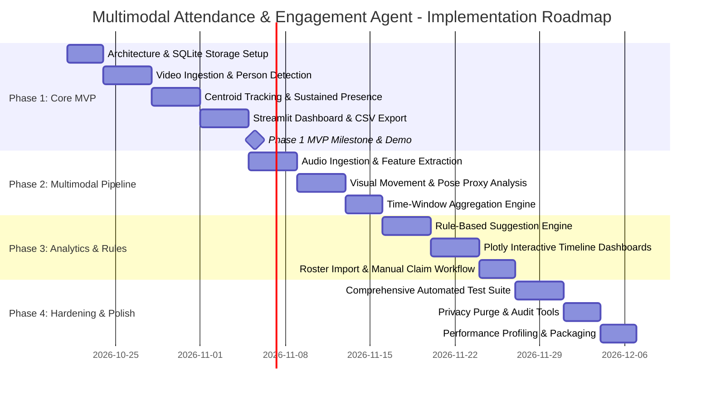

# Multimodal Attendance & Engagement Agent
## Software Requirements Specification (SRS), Architecture, & Implementation Blueprint

---

### Document Control
- **Project Name:** Multimodal Attendance & Engagement Agent
- **Target Architecture:** Offline-First Modular Desktop / Edge Web Application
- **Author:** Senior AI/ML Engineer & Systems Architect
- **Status:** Approved Architecture Blueprint
- **Version:** 1.0.0

---

## 1. Executive Summary & Objective

The **Multimodal Attendance & Engagement Agent** is an offline-first classroom intelligence application designed for educators. It records verified session attendance, analyzes observable classroom activity dynamics via video and optional audio, generates timely and constructive rule-based pedagogical suggestions, and presents actionable analytics via an intuitive local Streamlit dashboard.

### Core Philosophy & Guiding Tenets
1. **Offline & Edge-First:** All processing executes on the teacher's local device without requiring internet access or third-party cloud APIs.
2. **Privacy by Design:** Raw audio and video streams are processed ephemerally in volatile memory and immediately discarded. Never persist raw media unless explicitly configured for diagnostic or archival mode with consent.
3. **Observables over Inferences:** The system measures *observable physical signals* (motion vectors, head orientation changes, speech presence, sound volume variance), rather than asserting unprovable internal states like "emotion", "focus", or "comprehension".
4. **Ethical Identity Decoupling:** Person detection strictly tracks anonymous bounding boxes and spatio-temporal trajectories. Attendance is associated with individual student identities **only** via teacher confirmation or opt-in student check-ins—never automated facial recognition.

---

## 2. Ethical Guardrails & System Constraints

```
┌─────────────────────────────────────────────────────────────────────────────┐
│                       ETHICAL & PRIVACY GUARDRAILS                          │
├──────────────────────────────────────┬──────────────────────────────────────┤
│ ❌ PROHIBITED PRACTICES              │ ✅ MANDATED ARCHITECTURAL PATTERNS   │
├──────────────────────────────────────┼──────────────────────────────────────┤
│ • Autonomous face recognition or     │ • Anonymous person tracking IDs      │
│   biometric matching to student names│   (e.g., Track-01, Track-02).        │
│ • Assigning student identities       │ • Teacher-confirmed roster matching   │
│   solely from video detection.       │   or self-service opt-in check-in.   │
│ • Inferring emotion, sentiment, or   │ • Observable physical activity       │
│   "true attentiveness" ground truth. │   indicators (motion delta, head pose│
│                                      │   direction variance, speech activity│
│ • Transmitting classroom media to    │ • 100% local, air-gapped processing  │
│   cloud AI endpoints.                │   using local models & algorithms.   │
│ • Unbounded raw video/audio storage. │ • Zero-retention memory buffers; raw │
│                                      │   frames discarded after inference.  │
│ • Stealth or unannounced monitoring. │ • Persistent on-screen privacy badge │
│                                      │   and explicit pre-session consent.  │
└──────────────────────────────────────┴──────────────────────────────────────┘
```

1. **Identity Separation:** Person detection and tracking IDs are ephemeral integers (e.g., `track_id=104`). Linking a `track_id` to a enrolled student record requires an explicit teacher action or voluntary student token input.
2. **Epistemic Modesty in Analytics:** Visual orientation and speech frequency are imperfect proxies for engagement. UI copy must always reflect observable behavior (e.g., *"Group Visual Movement: Active"* or *"Speech Ratio: 45%"*), avoiding misleading claims like *"Student 3 is Bored"*.
3. **Consent & Notice Protocol:** A session cannot commence without displaying an explicit data notice acknowledging offline processing and data retention policies.

---

## 3. Stakeholders & User Personas

| Persona | Primary Goals | Key Pain Points Addressed |
| :--- | :--- | :--- |
| **Classroom Teacher** | Streamline manual roll call; identify lecture pacing lulls; receive constructive cues on classroom interaction balance. | Eliminates roll call overhead (saves 5–10 min); provides unbiased feedback on teacher monologue vs. student interaction. |
| **Student** | Preserved biometric privacy; fair, transparent attendance verification; protected from algorithmic judgment. | No biometric facial database; no subjective "emotion detection" impacting grades; strict local data storage. |
| **Institutional Admin / Auditor** | Compliance with FERPA/GDPR student privacy laws; auditable attendance logs; reproducible offline operation. | Zero external data leaks; verifiable SQLite audit trails; customizable data purge schedules. |

---

## 4. Functional Requirements (FR-1 through FR-16)

### Module 1: Session Management & Lifecycle
- **FR-01.1 (Session Setup):** The system shall allow the teacher to create a new session specifying `course_code`, `session_title`, `scheduled_duration`, and optional `roster_id`.
- **FR-01.2 (Lifecycle State Machine):** The system shall manage four distinct states: `READY`, `ACTIVE`, `PAUSED`, `CONCLUDED`. Transitions must be timestamped in UTC and local time.
- **FR-01.3 (State Persistence):** Session metadata, state transitions, and total elapsed active duration must be persisted to SQLite immediately upon state change.

### Module 2: Video Ingestion & Hardware Interface
- **FR-02.1 (Multi-Source Video):** The system shall support live USB/Integrated webcams (via OpenCV `cv2.VideoCapture(index)`) and pre-recorded video files (`.mp4`, `.avi`, `.mkv`, `.mov`).
- **FR-02.2 (Decoupled Frame Producer):** Video capture must run in a dedicated producer thread with a thread-safe frame queue (`maxsize=2`) to prevent blocking UI interactions.
- **FR-02.3 (Frame Rate Adaptation):** Inference processing shall sub-sample incoming video to a configurable target rate (default: 5–10 FPS) to ensure smooth operation on standard CPU hardware.

### Module 3: Vision Perception & Tracking
- **FR-03.1 (Person Detection):** The system shall detect human presence in video frames using an offline lightweight detector (OpenCV YuNet / Haar Cascade or MediaPipe Object/Pose detector).
- **FR-03.2 (Multi-Object Tracking):** The system shall assign persistent, anonymous tracking IDs across frames using a spatial-temporal tracker (Centroid Tracker / SORT / ByteTrack) with maximum lost-frame tolerance (default: 30 frames).
- **FR-03.3 (Visual Proxy Features):** For each tracked person, the system shall compute:
  - *Spatial Bounding Box:* `[x, y, w, h]` and centroid coordinates.
  - *Movement Delta:* Frame-to-frame centroid displacement and optical flow magnitude within the bounding box.
  - *Head Orientation Proxy:* Rough yaw/pitch orientation vector (using MediaPipe FaceMesh/Face detector or frontal/profile face cascade ratios).

### Module 4: Sustained-Presence Attendance Engine
- **FR-04.1 (Presence Accumulator):** The system shall accumulate active presence time for each anonymous `track_id` across the session timeline.
- **FR-04.2 (Sustained Thresholding):** A track shall transition from `DETECTED` to `SUSTAINED_PRESENT` only when cumulative detected time exceeds a configurable presence threshold (e.g., minimum 5 continuous minutes or >= 60% of total session elapsed time).
- **FR-04.3 (Attendance Ledger):** For each tracked subject, the system shall log: `first_detected_timestamp`, `last_detected_timestamp`, `total_sustained_seconds`, and `attendance_status` (`PRESENT`, `PARTIAL`, `ABSENT`).

### Module 5: Identity Association & Roster Management
- **FR-05.1 (Roster Import):** The system shall allow importing course rosters from standard CSV formats (`student_id`, `student_name`, `email`).
- **FR-05.2 (Teacher-Confirmed Claim):** The teacher dashboard shall provide a verification UI allowing the instructor to assign or confirm a tracked presence slot to a roster entry with a single click.
- **FR-05.3 (Opt-in Token Check-in):** The system shall support a secondary voluntary check-in mechanism where students supply a 4-digit session code or local QR code token to confirm roster attendance without biometric scanning.
- **FR-05.4 (Strict Anti-Recognition Enforcement):** Under no circumstance shall the system attempt automated facial identification against student name directories.

### Module 6: Audio Ingestion & Acoustic Feature Extraction
- **FR-06.1 (Optional Audio Source):** The system shall ingest live microphone audio (via PyAudio / SoundDevice) or recorded audio tracks (`.wav`, `.mp3`) when enabled by the instructor.
- **FR-06.2 (Voice Activity Detection - VAD):** The system shall evaluate short audio frames (20–30ms) using energy and zero-crossing thresholds or lightweight WebRTC-VAD to segment audio into `SPEECH` vs `SILENCE`.
- **FR-06.3 (Acoustic Descriptors):** The system shall compute time-windowed acoustic features using `librosa`/`numpy`:
  - *Root Mean Square (RMS) Energy:* Amplitude/loudness dynamics.
  - *Spectral Centroid:* Audio brightness and frequency balance.
  - *Zero-Crossing Rate (ZCR):* Spectral noise and voice inflection indicator.
- **FR-06.4 (Speech Distribution Metric):** The system shall estimate the ratio of teacher monologue vs. collective classroom interaction based on sound level shifts and conversational turn pacing.

### Module 7: Multimodal Windowed Aggregator
- **FR-07.1 (Tumbling Time Windows):** The system shall bucket raw visual and acoustic metrics into uniform time intervals (configurable: 30s, 60s, or 300s).
- **FR-07.2 (Composite Metric Calculation):** For each window $W_k$, the engine shall calculate:
  - *Mean Active People Count:* $\bar{P}_k$
  - *Aggregated Visual Movement Index:* $V_k \in [0, 100]$
  - *Head Orientation Stability Index:* $H_k \in [0, 100]$
  - *Speech Activity Percentage:* $S_k \in [0, 100]$
  - *Acoustic Energy Variance:* $\sigma^2_{RMS, k}$

### Module 8: Rule-Based Pedagogical Suggestion Engine
- **FR-08.1 (Deterministic Rule Matrix):** The system shall trigger context-aware pedagogical hints based on threshold triggers evaluated on rolling time windows:

| Trigger Condition | Threshold Pattern | Suggestion Type | Recommended Pedagogical Prompt |
| :--- | :--- | :--- | :--- |
| **Prolonged Monologue** | $S_k > 85\%$ for $\ge 10\text{ min}$ & $V_k < 15$ | Pacing Cue | *"Continuous presentation detected for 10 min. Consider pausing for a quick comprehension check or polling the class."* |
| **Extended Dead Silence** | $S_k < 5\%$ for $\ge 3\text{ min}$ during active lecture | Engagement Cue | *"Extended silence observed. If this is an independent exercise, all is well; if open floor, consider prompting with a guided question."* |
| **Lively Discussion** | $S_k \in [40\%, 75\%]$ & $\sigma^2_{RMS} > \text{med}$ | Positive Reinforcement | *"Balanced acoustic activity indicates active student dialogue or Q&A interaction."* |
| **Visual Restlessness Spike** | $V_k > 75\%$ & $S_k < 10\%$ for $\ge 4\text{ min}$ | Dynamics Alert | *"Elevated physical movement detected during silence. Students may be finishing tasks or experiencing cognitive fatigue."* |
| **Sudden Presence Drop** | Active Count drops $> 25\%$ mid-session | Attendance Warning | *"Significant drop in detected classroom presence. Check camera field of view or verify if break is underway."* |

- **FR-08.2 (Non-Judgmental Copy):** All generated suggestions must employ supportive, neutral language that serves as an assistant cue rather than an evaluative judgment.

### Module 9: Teacher Dashboard & Interactive Analytics
- **FR-09.1 (Live Session Monitor):** Display real-time video feed with anonymized bounding box overlays, live headcount gauge, active presence timer, and current audio level meter.
- **FR-09.2 (Session Timeline View):** Interactive Plotly multi-axis chart showing synchronized visual activity index, speech activity %, and detected person count across the session timeline.
- **FR-09.3 (Attendance Verification Table):** Interactive table showing tracking IDs, sustained duration, verification badges, and dropdowns for roster association.
- **FR-09.4 (Suggestion Feed):** Live reverse-chronological notification list displaying triggered suggestions with timestamps and dismiss/acknowledge toggles.

### Module 10: Reporting, Export & Local Persistence
- **FR-10.1 (Data Export):** The system shall export session summaries and student attendance records to standard CSV files.
- **FR-10.2 (Local SQLite Storage):** All schemas, session details, aggregated window metrics, and teacher-confirmed attendance records must be stored in a local SQLite file (`attendance_agent.db`).
- **FR-10.3 (Data Retention & Purge Tool):** The system shall provide an administrative setting to automatically purge session records older than $N$ days (configurable: 7, 30, 90 days, or immediate purge).

---

## 5. Non-Functional Requirements (NFRs)

### 5.1 Performance & Resource Efficiency
- **NFR-01 (Inference Latency):** Video frame inference + tracking pipeline must complete within $\le 100\text{ ms}$ per processed frame on a standard quad-core Intel i5/Apple M1 CPU without requiring a dedicated GPU.
- **NFR-02 (Memory Ceiling):** Peak application memory consumption (Streamlit + OpenCV + Librosa) must not exceed $1.2\text{ GB}$ RAM during a 2-hour continuous session.
- **NFR-03 (Frame Dropping Tolerance):** When the processing pipeline lags behind camera ingestion, older unread frames in the buffer must be cleanly discarded to preserve real-time synchronization.

### 5.2 Offline Availability & Portability
- **NFR-04 (100% Offline Capability):** The application must initialize, process streams, compute analytics, and generate reports without active internet connectivity or local network egress.
- **NFR-05 (Cross-Platform Execution):** Core logic must execute cleanly across macOS (x86_64 and Apple Silicon), Linux (Ubuntu 22.04+), and Windows 11.
- **NFR-06 (Fallback Modularity):** If MediaPipe dependencies are restricted or incompatible with specific Python versions (e.g., Python 3.13), the vision engine must automatically fall back to native OpenCV detectors (YuNet / Haar) without crashing.

### 5.3 Privacy, Security & Data Protection
- **NFR-07 (Ephemeral Raw Streams):** Raw video frames and raw audio byte arrays must reside exclusively in transient memory (`heap`) and never be committed to disk storage unless explicitly toggled in an opt-in debug session.
- **NFR-08 (Zero External Egress):** The application shall not establish any outbound HTTP/S sockets or telemetry transmissions.
- **NFR-09 (Database Security):** SQLite database files must be stored within user-restricted permissions (`0600` on POSIX systems) in the local application workspace.

### 5.4 Code Quality, Reliability & Maintainability
- **NFR-10 (Test Coverage):** Unit and integration test suites must achieve $\ge 80\%$ statement coverage for core business logic (tracking, attendance thresholding, window aggregation, and rule engine).
- **NFR-11 (Graceful Degradation):** In the event of camera or microphone disconnection mid-session, the application must pause processing, log a warning, and allow the user to re-select hardware without data loss.

---

## 6. User Stories & Acceptance Criteria

### US-01: Session Initialization & Consent Check
**As a** classroom teacher,  
**I want to** initialize a class session with clear privacy notice and device selection,  
**So that** I ensure compliant, informed classroom observation.

- **Scenario: Initializing a Session with Webcam**
  - **Given** the teacher launches the application dashboard,
  - **When** the teacher navigates to "New Session", inputs Course "CS101", and confirms the Privacy & Consent Notice,
  - **Then** the session state changes to `READY`, hardware devices are validated, and the "Start Session" button becomes active.

---

### US-02: Sustained-Presence Attendance Tracking
**As a** classroom teacher,  
**I want** the system to track anonymous students and mark them present only after sustained attendance,  
**So that** momentary passers-by or brief room walk-ins do not get logged as attendees.

- **Scenario: Filtering out a transient passer-by**
  - **Given** a session is `ACTIVE` with a sustained-presence threshold of 5 minutes,
  - **When** an individual enters the camera view for 45 seconds and leaves,
  - **Then** a `track_id` is recorded with 45s presence, but attendance status remains `ABSENT / TRANSIENT`, and the person is not credited with verified attendance.
- **Scenario: Verifying sustained student presence**
  - **Given** a student is detected in the classroom for 42 minutes of a 50-minute session,
  - **When** the session concludes,
  - **Then** the `track_id` is classified as `SUSTAINED_PRESENT` (84% presence duration).

---

### US-03: Teacher-Confirmed Roster Association
**As a** classroom teacher,  
**I want to** match sustained anonymous presence records to my enrolled roster manually or via token check-in,  
**So that** attendance is verified without performing automated facial identification.

- **Scenario: Teacher associates Track ID with student name**
  - **Given** Track-03 has achieved `SUSTAINED_PRESENT` status,
  - **When** the teacher selects "Jane Doe" from the unassigned roster dropdown in the attendance table,
  - **Then** Track-03 is linked to Jane Doe, an audit log entry is written (`assigned_by=TEACHER_CONFIRMATION`), and Jane Doe is marked present in the final export.

---

### US-04: Offline Video File Analysis
**As an** educational researcher or instructor,  
**I want to** process a pre-recorded lecture video file,  
**So that** I can review past classroom dynamics and generate attendance/activity reports post-hoc.

- **Scenario: Processing recorded video file**
  - **Given** a valid `.mp4` file of a 30-minute class session,
  - **When** the teacher uploads/selects the file and clicks "Analyze Recorded Video",
  - **Then** the video is decoded offline frame-by-frame, tracking trajectories and activity metrics are computed, and a complete analytics summary is displayed.

---

### US-05: Real-Time Pedagogical Suggestion Delivery
**As a** teacher in the middle of a class,  
**I want** subtle, timely cues if I have been lecturing without interaction for an extended period,  
**So that** I can adjust my pedagogical pacing and re-engage the classroom.

- **Scenario: Suggestion triggered by long monologue**
  - **Given** audio speech activity has exceeded 85% for 10 consecutive minutes while visual movement is low,
  - **When** the current 60s aggregation window evaluates,
  - **Then** a non-intrusive suggestion badge appears on the dashboard: *"Continuous presentation detected for 10 min. Consider pausing for a quick comprehension check."*

---

### US-06: Data Export & Privacy Purge
**As a** privacy-conscious teacher,  
**I want to** export the final attendance spreadsheet and completely purge temporary session metrics,  
**So that** no lingering classroom monitoring data remains on the system.

- **Scenario: Exporting CSV and purging records**
  - **Given** a concluded session with verified attendance,
  - **When** the teacher clicks "Download Attendance CSV" and then triggers "Purge Session Telemetry",
  - **Then** the CSV file downloads successfully, and all raw activity window rows for that session in SQLite are securely deleted.

---

## 7. Modular Software Architecture

```
┌─────────────────────────────────────────────────────────────────────────────┐
│                           PRESENTATION LAYER                                │
│                     (Streamlit Web Interface & UI)                          │
│  ┌───────────────────┐  ┌───────────────────┐  ┌─────────────────────────┐  │
│  │ Live Stream &     │  │ Session Timeline  │  │ Roster Claim &          │  │
│  │ Bounding Overlays │  │ (Plotly Charts)   │  │ Verification Table      │  │
│  └─────────▲─────────┘  └─────────▲─────────┘  └────────────▲────────────┘  │
└────────────┼──────────────────────┼─────────────────────────┼───────────────┘
             │                      │                         │
┌────────────┴──────────────────────┴─────────────────────────┴───────────────┐
│                    APPLICATION & ORCHESTRATION LAYER                         │
│                    (SessionController & State Engine)                       │
│  ┌───────────────────────────────────────────────────────────────────────┐  │
│  │ State Machine: [READY] -> [ACTIVE] <-> [PAUSED] -> [CONCLUDED]        │  │
│  └───────────────────┬───────────────────────────────┬───────────────────┘  │
└──────────────────────┼───────────────────────────────┼──────────────────────┘
                       │                               │
       ┌───────────────▼───────────────┐               │
       │     MULTIMODAL INGESTION      │               │
       │   ┌────────────────────────┐  │               │
       │   │ Video Ingestion Worker │  │               │
       │   │ (OpenCV / Thread Queue)│  │               │
       │   └───────────┬────────────┘  │               │
       │   ┌───────────▼────────────┐  │               │
       │   │ Audio Ingestion Worker │  │               │
       │   │ (PyAudio / SoundDevice)│  │               │
       │   └───────────┬────────────┘  │               │
       └───────────────┼───────────────┘               │
                       │                               │
       ┌───────────────▼───────────────┐               │
       │  PERCEPTION & FEATURE CORE    │               │
       │   ┌────────────────────────┐  │               │
       │   │ VisionEngine:          │  │               │
       │   │ • Person Detector      │  │               │
       │   │ • SORT / CentroidTrack │  │               │
       │   │ • Motion / Pose Proxy  │  │               │
       │   └───────────┬────────────┘  │               │
       │   ┌───────────▼────────────┐  │               │
       │   │ AudioEngine:           │  │               │
       │   │ • Energy (RMS) & ZCR   │  │               │
       │   │ • VAD / Speech Window  │  │               │
       │   └───────────┬────────────┘  │               │
       └───────────────┼───────────────┘               │
                       │                               │
       ┌───────────────▼───────────────────────────────▼──┐
       │             ANALYTICS & ADVISORY ENGINE          │
       │  ┌────────────────────────┐  ┌────────────────┐  │
       │  │ Time-Window Aggregator │  │ Rule-Based     │  │
       │  │ (30s/60s Sliding Metric│  │ Pedagogical    │  │
       │  │  Tumbling Windows)     │  │ Suggestion Cues│  │
       │  └────────────┬───────────┘  └────────┬───────┘  │
       │  ┌────────────▼───────────────────────▼───────┐  │
       │  │ Sustained-Presence Attendance Evaluator    │  │
       │  └────────────────────┬───────────────────────┘  │
       └───────────────────────┼──────────────────────────┘
                               │
┌──────────────────────────────▼──────────────────────────────────────────────┐
│                        DATA PERSISTENCE LAYER                               │
│                         (SQLite Local DB)                                   │
│  ┌──────────────┐  ┌──────────────┐  ┌──────────────┐  ┌─────────────────┐  │
│  │ sessions     │  │ students     │  │ attendance   │  │ activity_windows│  │
│  └──────────────┘  └──────────────┘  └──────────────┘  └─────────────────┘  │
└─────────────────────────────────────────────────────────────────────────────┘
```

### 7.1 Layer Responsibilities & Module Boundaries

| Module | Source Directory | Primary Classes / Components | Key Responsibility |
| :--- | :--- | :--- | :--- |
| **Presentation** | `src/ui/` | `DashboardView`, `LiveFeedComponent`, `AnalyticsCharts`, `RosterManagerView` | Renders Streamlit components, handles user events, plots Plotly charts. |
| **Orchestrator** | `src/controllers/` | `SessionController`, `SessionStateMachine` | Coordinates lifecycle, routes data between workers and repositories. |
| **Ingestion** | `src/ingestion/` | `VideoSource` (Webcam/File), `AudioSource` (Mic/File), `FrameQueue` | Threaded capture of raw frames and audio buffers with zero copy. |
| **Perception** | `src/perception/` | `PersonDetector`, `CentroidTracker`, `MotionAnalyzer`, `AudioFeatureExtractor` | Extracts bounding boxes, track trajectories, optical flow, RMS energy, and VAD flags. |
| **Analytics** | `src/analytics/` | `WindowAggregator`, `AttendanceEngine`, `SuggestionEngine` | Computes time-window statistics, evaluates sustained presence, triggers pedagogical rules. |
| **Persistence** | `src/storage/` | `DatabaseManager`, `SessionRepository`, `AttendanceRepository`, `ExportManager` | SQLite CRUD operations, connection pooling, and CSV serialization. |

### 7.2 Database Schema (SQLite Relational Model)

```sql
-- 1. Sessions Table
CREATE TABLE IF NOT EXISTS sessions (
    session_id TEXT PRIMARY KEY,
    course_code TEXT NOT NULL,
    session_title TEXT NOT NULL,
    status TEXT CHECK(status IN ('READY', 'ACTIVE', 'PAUSED', 'CONCLUDED')) NOT NULL,
    created_at TIMESTAMP DEFAULT CURRENT_TIMESTAMP,
    started_at TIMESTAMP,
    concluded_at TIMESTAMP,
    total_active_seconds REAL DEFAULT 0.0,
    sustained_threshold_pct REAL DEFAULT 60.0,
    video_source_type TEXT NOT NULL,
    audio_enabled INTEGER DEFAULT 1
);

-- 2. Students (Roster) Table
CREATE TABLE IF NOT EXISTS students (
    student_id TEXT PRIMARY KEY,
    course_code TEXT NOT NULL,
    full_name TEXT NOT NULL,
    email TEXT,
    created_at TIMESTAMP DEFAULT CURRENT_TIMESTAMP
);

-- 3. Anonymous Attendance Ledger
CREATE TABLE IF NOT EXISTS attendance_records (
    record_id TEXT PRIMARY KEY,
    session_id TEXT NOT NULL REFERENCES sessions(session_id) ON DELETE CASCADE,
    track_id INTEGER NOT NULL,
    first_seen_timestamp REAL NOT NULL,
    last_seen_timestamp REAL NOT NULL,
    total_detected_seconds REAL NOT NULL,
    sustained_presence_status TEXT CHECK(sustained_presence_status IN ('SUSTAINED_PRESENT', 'PARTIAL', 'TRANSIENT')) NOT NULL,
    assigned_student_id TEXT REFERENCES students(student_id) ON DELETE SET NULL,
    verification_method TEXT CHECK(verification_method IN ('ANONYMOUS', 'TEACHER_CONFIRMED', 'OPT_IN_TOKEN')) DEFAULT 'ANONYMOUS',
    verified_at TIMESTAMP,
    UNIQUE(session_id, track_id)
);

-- 4. Windowed Multimodal Activity Metrics
CREATE TABLE IF NOT EXISTS activity_windows (
    window_id TEXT PRIMARY KEY,
    session_id TEXT NOT NULL REFERENCES sessions(session_id) ON DELETE CASCADE,
    window_start_sec REAL NOT NULL,
    window_end_sec REAL NOT NULL,
    active_person_count INTEGER NOT NULL,
    visual_movement_index REAL NOT NULL, -- 0.0 to 100.0
    head_pose_variance REAL NOT NULL,    -- 0.0 to 100.0
    speech_activity_pct REAL NOT NULL,   -- 0.0 to 100.0
    rms_energy_mean REAL NOT NULL,
    created_at TIMESTAMP DEFAULT CURRENT_TIMESTAMP
);

-- 5. Triggered Teaching Suggestions Log
CREATE TABLE IF NOT EXISTS teaching_suggestions (
    suggestion_id TEXT PRIMARY KEY,
    session_id TEXT NOT NULL REFERENCES sessions(session_id) ON DELETE CASCADE,
    timestamp_sec REAL NOT NULL,
    trigger_rule_code TEXT NOT NULL,
    suggestion_text TEXT NOT NULL,
    acknowledged INTEGER DEFAULT 0
);
```

---

## 8. AI/ML Models vs. Deterministic Rules Boundary

A critical architectural mandate is separating where statistical machine learning models are genuinely required versus where transparent, deterministic mathematical and signal-processing rules must be used.

```
┌─────────────────────────────────────────────────────────────────────────────┐
│                          AI/ML vs. DETERMINISTIC RULES                      │
├──────────────────────────────────────┬──────────────────────────────────────┤
│ 🤖 TRAINED AI / ML MODELS (OFFLINE)  │ 📐 DETERMINISTIC MATHEMATICAL RULES  │
├──────────────────────────────────────┼──────────────────────────────────────┤
│ 1. Person / Human Bounding Box       │ 1. Multi-Object Tracking & ID Link   │
│    Detection                         │    (Euclidean distance matching,     │
│    • OpenCV YuNet / Haar / HOG       │     Hungarian algorithm, Kalman).    │
│    • MediaPipe Pose/Object detection │ 2. Sustained-Presence Thresholding   │
│                                      │    (Cumulative time >= T_threshold). │
│ 2. Landmark / Face Orientation Proxy │ 3. Optical Flow / Movement Scoring   │
│    • MediaPipe FaceMesh / Face       │    (Farneback dense flow magnitude   │
│      detector or OpenCV cascade      │     or frame-difference delta).      │
│      geometry for yaw/pitch angles.  │ 4. Acoustic Features & VAD           │
│                                      │    (RMS energy, Zero-Crossing Rate,  │
│ 3. Offline Voice Activity Detection  │     energy-ratio thresholding).      │
│    (Optional ML mode)                │ 5. Time-Window Aggregation           │
│    • WebRTC-VAD (Gaussian Mixture    │    (Summary statistics, percentiles).│
│      Model) for robust noise rejection│ 6. Pedagogical Suggestions          │
│                                      │    (Deterministic decision matrix:   │
│                                      │     IF speech > X AND movement < Y).  │
│                                      │ 7. Roster Identification             │
│                                      │    (Strict manual claim / PIN opt-in).│
└──────────────────────────────────────┴──────────────────────────────────────┘
```

### Detailed Rationale
1. **Perception (Vision & Voice):** Detecting arbitrary human shapes and speech boundaries in varying classroom lighting and ambient acoustics benefits from pretrained statistical weights (such as OpenCV YuNet or MediaPipe). These run purely on local weights without cloud inference.
2. **Pedagogical Suggestions (Deterministic):** Using LLMs or black-box classifiers to evaluate teacher performance introduces hallucination, unpredictability, and ungrounded bias. Deterministic threshold rules guarantee that suggestions are 100% reproducible, explainable, and trustworthy.
3. **Attendance & Identity (Deterministic):** Because biometric facial recognition is strictly excluded, all identity binding operates on deterministic relational keys confirmed by the human instructor.

---

## 9. Technical & Privacy Risk Assessment

| Risk Category | Identified Hazard | Severity / Likelihood | Concrete Mitigation Architecture |
| :--- | :--- | :--- | :--- |
| **Technical** | **Python 3.13 / MediaPipe Wheel Incompatibility**<br>Pre-compiled MediaPipe wheels may lag behind newer Python minor releases. | **High / High** | Implement a **Pluggable Vision Backend Interface** (`BaseDetector`). Provide native `OpenCVYuNetDetector` / `HaarDetector` as default or zero-dependency fallback, loading `MediaPipeDetector` only when available. |
| **Technical** | **Live Audio Capture Device Lock / Permissions**<br>Operating system microphone permissions may fail or trigger crashes. | **Medium / Medium** | Graceful audio isolation: if audio device fails or mic is denied, audio subsystem switches to `DUMMY_SILENT_SOURCE` without terminating video or attendance tracking. |
| **Technical** | **Real-Time CPU Starvation & UI Lag**<br>Simultaneous frame decoding, tracking, and Streamlit re-renders can choke CPU cores. | **High / Medium** | 1. Run video capture and inference in background threads.<br>2. Sub-sample inference to 5–8 FPS.<br>3. Throttle Streamlit UI refresh to 2–4 Hz using session state caching. |
| **Technical** | **Tracking ID Drift & Occlusion**<br>Students walking behind pillars or turning around may spawn new `track_id`s. | **Medium / High** | Spatial centroid tolerance buffer and minimum sustained time requirement filter out spurious transient fragments. Provide teacher UI to merge split tracks. |
| **Privacy / Ethical** | **Creep Factor & Surveillance Perception**<br>Students or faculty may fear biometric surveillance or emotional grading. | **Critical / High** | 1. Prominent persistent UI banner: *"Privacy Mode: Anonymous Presence Only. No Biometric ID. No Facial Recognition. No Raw Video Saved."*<br>2. Strict avoidance of emotion/sentiment terminology in reports. |
| **Privacy** | **Accidental Raw Media Persistence**<br>Raw video frames inadvertently written to temporary files or caches. | **Critical / Low** | Ephemeral processing pipeline: frames remain in RAM (`np.ndarray`) and are garbage-collected immediately. Automated tests verify no `.mp4`/`.jpg` artifacts are created in working directories. |
| **Data Integrity** | **Mid-Session App Crash or Power Outage**<br>Sudden power failure causing SQLite corruption or lost attendance records. | **Medium / Low** | WAL (Write-Ahead Logging) mode enabled on SQLite; atomic per-window commits; recovery on startup for interrupted sessions. |

---

## 10. Phased Implementation Roadmap



### Phase Details

#### Phase 1: Core Attendance MVP (Foundation)
- **Goal:** Deliver an end-to-end working pipeline tracking sustained presence and generating verified attendance CSV reports.
- **Deliverables:**
  - SQLite database schema & repository access layer.
  - Video ingestion worker supporting local webcam and recorded MP4 video.
  - Anonymous person detector with fallback support (OpenCV YuNet / Haar).
  - Sustained-presence calculation engine (configurable $T_{sustained}$).
  - Minimal Streamlit dashboard: Session lifecycle controls, live tracking preview, attendance summary table, CSV export.

#### Phase 2: Multimodal Activity Engine (Audio & Dynamics)
- **Goal:** Add acoustic and visual motion intelligence without violating privacy constraints.
- **Deliverables:**
  - Audio ingestion worker for microphone and audio tracks.
  - Librosa/NumPy feature extractor (RMS energy, ZCR, speech activity percentage).
  - Optical flow / motion vector extractor for visual restlessness index.
  - Rolling time-window aggregator (30s / 60s windows).

#### Phase 3: Pedagogical Suggestions & Deep Analytics
- **Goal:** Transform windowed metrics into actionable teacher feedback and rich timeline visualizations.
- **Deliverables:**
  - Deterministic suggestion engine with explainable rule matrix.
  - Interactive multi-axis Plotly timeline charts (Activity vs. Speech vs. Attendance).
  - Teacher roster claim and student PIN check-in workflow.

#### Phase 4: Governance, Testing & Production Hardening
- **Goal:** Ensure bulletproof stability, performance, and compliance.
- **Deliverables:**
  - Pytest suite covering unit, integration, and mock hardware pipelines ($\ge 80\%$ coverage).
  - Automatic retention policy manager (data auto-purge).
  - CPU optimization, frame dropping safeguards, and cross-platform packaging documentation.

---

## 11. Minimal Viable Product (MVP) Specification

The **MVP** is designed to validate the foundational value proposition—accurate, anonymous, sustained-presence attendance tracking with zero privacy friction—before activating complex multimodal audio algorithms.

### MVP Scope & Boundaries
- **Input Modality:** 
  - Live webcam (`cv2.VideoCapture(0)`) **OR** pre-recorded classroom `.mp4` video.
  - Audio disabled in MVP (or optional mock placeholder) to ensure zero device friction during the initial milestone.
- **Core Processing Engine:**
  - Lightweight person detection (OpenCV native detector with MediaPipe toggle).
  - Centroid-based Multi-Object Tracker generating anonymous IDs (`Track-01`, `Track-02`, etc.).
  - Sustained-presence timer: logs exact entry time, last seen time, and total seconds present.
  - Presence status calculation: `SUSTAINED_PRESENT` if detected $\ge 60\%$ of active session duration; else `PARTIAL` / `TRANSIENT`.
- **User Interface (Streamlit):**
  - Session Creator (Course Code, Title, Threshold slider).
  - Live monitoring panel with bounding boxes and track ID labels.
  - Real-time attendee counter and live attendance status table.
  - Session Controller (Start, Pause, Conclude).
  - Roster Claim Dropdown (map Track ID $\to$ enrolled student name).
  - "Export Attendance CSV" button.
- **Demonstration Criteria:**
  1. Load a pre-recorded classroom video or run a live webcam session for 3 minutes.
  2. Demonstrate an attendee sitting continuously vs. a person walking past the camera for 5 seconds.
  3. Verify that the continuous person is marked `SUSTAINED_PRESENT` while the transient walker is flagged as `TRANSIENT`.
  4. Teacher maps the confirmed track to a student name.
  5. Download the CSV report verifying that timestamps, total minutes, and presence statuses match ground truth.
  6. Confirm zero raw video files were saved to disk.

---

## 12. Acceptance Test Matrix

| ID | Test Scenario | Expected Outcome | Verification Method |
| :--- | :--- | :--- | :--- |
| **ATM-01** | Session creation with valid parameters | Session record inserted into SQLite with status `READY`. | Database query inspection & UI confirmation. |
| **ATM-02** | Live webcam frame acquisition | Video stream displays in Streamlit with $> 5\text{ FPS}$ without freezing. | Visual inspection & FPS counter. |
| **ATM-03** | Person detection & anonymous bounding box | People in view receive yellow bounding box and `ID: <int>`. | Visual inspection of preview stream. |
| **ATM-04** | Sustained-presence calculation | Person present $> 60\%$ of duration marked `SUSTAINED_PRESENT`; person $< 60\%$ marked `PARTIAL`. | Automated unit test & live session audit. |
| **ATM-05** | Strict no-facial-recognition enforcement | No biometric template or embedding tables exist in database. | Schema inspection & code audit. |
| **ATM-06** | Teacher roster association | Linking `Track-01` to "Alice Smith" updates `assigned_student_id` and audit log. | UI action followed by SQLite query. |
| **ATM-07** | CSV Export integrity | Generated CSV contains correct columns: `student_id`, `name`, `first_seen`, `last_seen`, `duration_min`, `status`. | Automated CSV parse test. |
| **ATM-08** | Ephemeral raw media guarantee | No `.jpg`, `.png`, `.mp4`, or raw audio files exist in workspace after session conclusion. | Filesystem directory scan. |
| **ATM-09** | Disconnected camera handling | Disconnecting camera pauses session gracefully and displays informative warning toast. | Hardware disconnect simulation. |
| **ATM-10** | Audio feature & VAD accuracy | Audio frames correctly split into Speech vs Silence within $\pm 10\%$ of manual annotation. | Pytest against reference `.wav` benchmark. |
